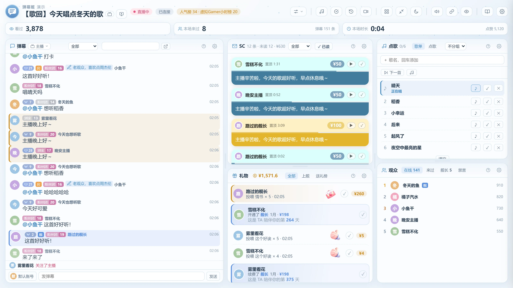
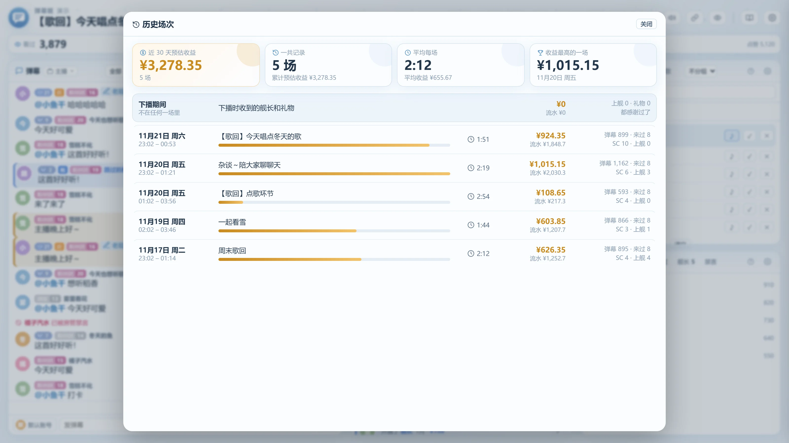
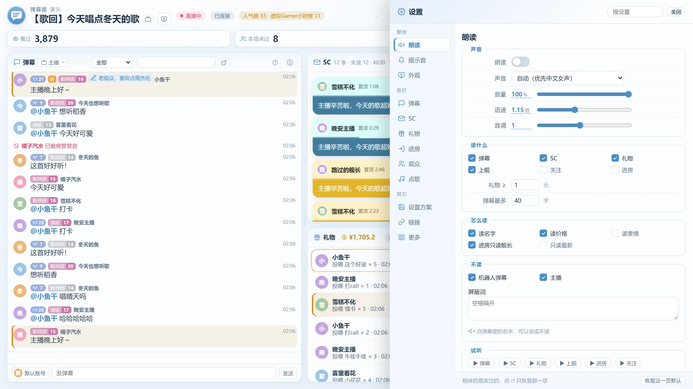
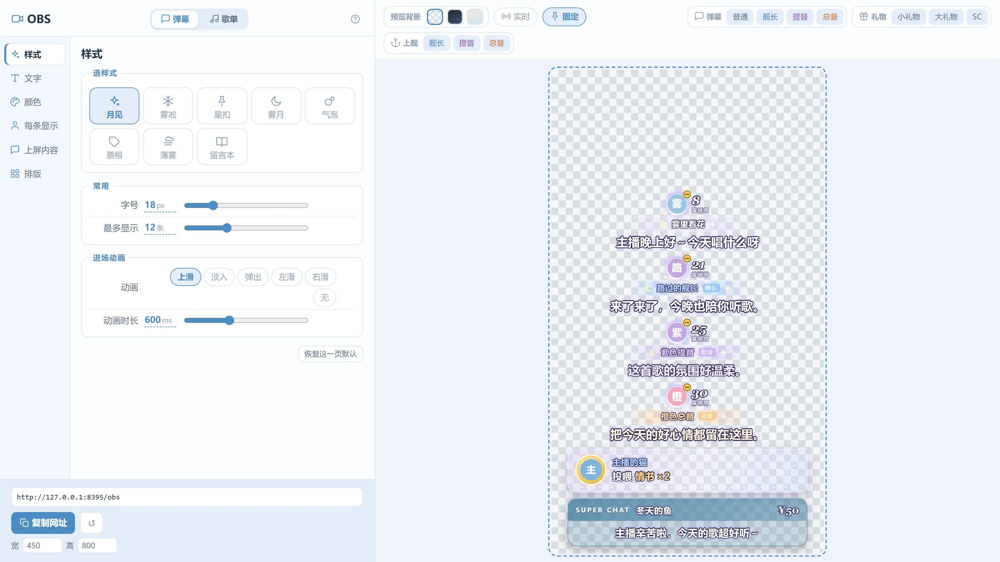

<a id="zh"></a>

# 弹幕姬 bili-danmaku-board

**中文** | [English](#english)

[](https://github.com/xShadowMoon/bili-danmaku-board/releases/latest)
[](LICENSE)

给 B 站主播用的弹幕工作台。在自己电脑上运行，连上你的直播间：弹幕、礼物、SC、上舰、点歌都在一个网页里看，还能直接给 OBS 当弹幕和歌单的浏览器源。每一场直播都会自动存档，下播后随时回看。

全部运行在你自己的电脑上，不需要服务器，也不会把数据传到别的地方。



---

## 怎么用（Windows）

1. 打开 [Releases](https://github.com/xShadowMoon/bili-danmaku-board/releases/latest)，下载 `bili-danmaku-board-vX.Y.Z-windows-x64.zip`（自带 Python，不用另外安装）。
2. 解压到一个固定的文件夹（不要直接在压缩包里双击运行），比如 `D:\弹幕姬\`。
3. 双击 `start.bat`。第一次会问你的**直播间号**（直播间网址 `live.bilibili.com/` 后面那串数字），填完自动保存。
4. 浏览器会自动打开 <http://127.0.0.1:8373>。在这台电脑上打开的页面拥有全部管理权限。
5. 要停止，关掉那个黑色窗口就行。下次再用还是双击 `start.bat`。

- 没开播也能先看看效果：双击 `demo.bat`，会在 <http://127.0.0.1:8375> 随机生成假弹幕、礼物和 SC，每种样式都能看一遍。
- 想换直播间、改端口，编辑文件夹里的 `config.json`（见下面「配置」）。
- 想让观众名字不被 B 站打码，需要一个 B 站账号的登录文件，见「常见问题」。

### 接到 OBS

1. 在弹幕姬右上角点「OBS 弹幕」，进入可视化设置页（`/obs-setup`），选样式、字号、颜色、要显示的内容，右边是实时预览。
2. 点左下角「复制网址」。
3. 在 OBS 里添加「浏览器」来源，把网址粘进去，宽高按设置页下面写的填。
4. 歌单也一样：设置页顶上切到「歌单」，复制网址再加一个浏览器来源。

### 更新到新版本

出了新版本时，弹幕姬顶栏「已连接」旁边会出现「有新版本 vX.Y.Z · 看看」，点开就是下载页（0.9.1 起才有这个提醒）。程序不会自己更新，按下面做：

1. 关掉弹幕姬的黑色窗口。
2. 从 [Releases](https://github.com/xShadowMoon/bili-danmaku-board/releases/latest) 下载新的 `windows-x64.zip`。
3. 解压后把里面的文件**覆盖**到原来的文件夹，提示重名时选「替换」。
4. 双击 `start.bat`。

直播间号、存档、观众备注、登录信息都在 `config.json` 和 `data\` 里，压缩包里没有这两样，所以覆盖不会丢；自己放进 `static\art\` 的图片也不会被换掉。保险起见，更新前可以先把 `data\` 复制一份。

从源码运行的话：`git pull`，再 `pip install -r requirements.txt`，然后重启。

---

## 能做什么

| 功能 | 说明 |
|---|---|
| 弹幕 | 表情显示成图片、粉丝牌（含未点亮的灰色牌）、荣耀等级、主播标签、高亮词；悬停暂停滚动，往上翻看整场，全场搜索，只看某类弹幕，弹幕小窗 |
| 发弹幕和回复 | 页内扫码登录自己的 B 站号发弹幕，可以直接回复某条弹幕；点名字能禁言、解除禁言 |
| SC | 置顶倒计时、重听、按金额筛选、标已读，已读状态在几台设备之间同步 |
| 礼物和上舰 | 礼物记录、刚送的礼物播 B 站官方动图、大礼物和上舰特效（优先用 B 站官方特效）、送礼榜（本场 / 本周 / 本月）、「开通 / 续费」「陪伴第 N 天」、下播期间收到的单独列出并可以标「已感谢」 |
| 观众 | 观众卡片（本场弹幕、送了多少、以前来过的记录）、备注、舰长名单和到期时间、在线的人、进房和新关注 |
| 点歌 | 歌单和完整曲库、弹幕点歌和点歌规则、「正在唱」「已唱」、拖动排序和分组、歌词提词小窗 |
| 朗读和提示音 | 用浏览器自带的声音朗读弹幕、SC、礼物，可以设过滤条件和屏蔽词；不同事件可以配不同提示音 |
| 历史 | 每场完整保存弹幕、礼物、SC 和上舰，概览里有收益、送礼榜、礼物和上舰统计 |
| OBS 弹幕 | `/obs` 8 种样式（月见、雾凇、星扣、雾月、气泡、票根、薄雾、留言本），10 款开源字体，描边阴影、按身份配色、屏蔽词，全部在 `/obs-setup` 里点选 |
| OBS 歌单 | `/obs-songs` 5 种样式（卡片、细条、唱片、薄雾、留言本） |
| 直播间 | 改标题和分区、常用标题一键切换、直播画面小窗、人气榜和小时榜、超管警告和切断提醒 |
| 开播前自检 | 一键检查和 B 站的连接、登录、OBS 能不能收到；工作模式（唱歌 / 聊天 / 房管）一键换布局 |
| 更新提醒 | GitHub 上出了新版本时，在顶栏提示（只有管理身份能看到），点开看更新内容和下载 |
| 布局 | 模块随意拖动、改大小、加减；主题色、配色、深色模式、紧凑模式；设置方案可以导出导入；能装成桌面应用（PWA） |
| 分享 | 只读的普通链接、可以随时新建和作废的管理链接、给主播本人用的专属链接（`/host`） |
| 切换直播间 | 临时去看你列出来的别的直播间，不影响自己的记录 |

### 界面一览









> 截图都来自演示模式（`demo.bat`），里面的观众和弹幕是随机生成的。

---

## 从源码运行（Windows / macOS / Linux）

需要 Python 3.11 或更新。

```sh
git clone https://github.com/xShadowMoon/bili-danmaku-board.git
cd bili-danmaku-board
pip install -r requirements.txt
cp config.example.json config.json   # 把 room 改成你的直播间号
python server.py                     # 然后打开 http://127.0.0.1:8373
```

Windows 上也可以直接双击 `start.bat`：它会自己找电脑上的 Python，第一次运行时自动装依赖、问直播间号。

不连直播间先看看：`python server.py --demo --port 8375`。

弹幕连接用的是 xfgryujk 的 [blivedm](https://github.com/xfgryujk/blivedm)（MIT），放在 `blivedm-src/` 里，有少量改动。

## 配置

`config.json`（除了 `room` 都可以不填；命令行参数会覆盖它，见 `python server.py --help`）：

| 键 | 含义 |
| --- | --- |
| `room` | 要连接的直播间号。 |
| `anchor_name` | 你的名字，显示在切换直播间的列表里。 |
| `port`、`host` | 网页监听的地址，默认 `127.0.0.1:8373`。 |
| `login_file` | 一个 B 站账号的登录文件，用来读取直播间（见常见问题）。默认 `data/bili-login.json`。 |
| `public_url` | 如果你把页面放到了公网，填公网地址（用于「隧道断了」提醒）。 |
| `discord_webhook` | 掉线提醒和每日体检发到的 Discord webhook。留空就不发。 |
| `bot_say_url` | 可选：用机器人账号发弹幕的本地接口（POST `{"text": ...}`，请求头 `X-Local-Token` 读自 `bot.token`）。 |
| `update_check` | 是否检查有没有新版本，默认 `true`。写 `false` 就不检查（也可以加命令行参数 `--no-update-check`）。 |

其他本地文件（都不会进 git，也不会打进 Release 压缩包）：

- `admin.key`：里面写一串随机字符就能开启一把长期管理链接（`/?admin=<那串字符>`）。更推荐在页面「设置 → 链接」里新建可作废的管理链接。
- `data/`：直播存档、设置、观众备注和登录的账号。记得备份，千万别公开。

### 分享给房管或主播

默认只监听 `127.0.0.1`，只有这台电脑能打开。想分享，就放在反向代理或隧道（比如 Cloudflare Tunnel）后面，并填好 `public_url`：

- **普通链接**：只读，看不到收益、礼物价格、历史和备注，也不能操作。
- **管理链接**：在「设置 → 链接」里新建，给房管用，可以随时作废或换新。
- **主播专属链接**（`/host`）：给主播本人，界面更简单。

### 自己的图片

除了应用图标，不带任何美术图。舰长徽章、头像框、上舰横幅和看板娘用到的文件名见 [`static/art/README.md`](static/art/README.md)，放进去刷新就生效。

---

## 常见问题

| 现象 | 原因和处理 |
|---|---|
| 观众名字被打码（中间变成 `*`） | B 站不给未登录的连接看完整名字。把一个 B 站账号的 Cookie 存成 `data/bili-login.json`，内容是 `{"cookie": "SESSDATA=...; bili_jct=...; DedeUserID=..."}`，重启后生效。**这个文件等于账号密码**，只放在自己电脑上，不要发给别人；建议用小号。 |
| 双击 `start.bat` 一闪就没了 | 多半是解压不完整，或者在压缩包里直接运行。完整解压到一个普通文件夹再试；还不行就在那个文件夹里打开命令行运行 `start.bat` 看报错。 |
| 提示端口 8373 被占用 | 可能已经开着一个弹幕姬，直接打开 <http://127.0.0.1:8373> 就行；要换端口，改 `config.json` 里的 `port`。 |
| 想换直播间 | 改 `config.json` 里的 `room`，关掉窗口重新打开。 |
| OBS 里什么都不显示 | 先在浏览器里打开同一个网址看看有没有弹幕；确认弹幕姬那个黑色窗口还开着；OBS 浏览器源的网址必须是从设置页复制的完整网址。也可以用顶栏「开播前自检 → OBS 测试」。 |
| 扫码登录没反应 | 用的是旧版的话缺 `qrcode` 依赖：源码运行时执行 `pip install -r requirements.txt`，或者下载新版 Windows 包。 |
| 别人打开我的公网链接看不到收益和历史 | 这是故意的：普通链接是只读视角。给信任的人发「管理链接」。 |
| 改标题、改分区提示没权限 | 这些操作要用**主播本人**的 B 站号扫码登录（发送框左边的头像）。 |
| 怎么看现在是哪个版本 | 鼠标停在「有新版本」标签上会写现在的版本；也可以在文件夹里运行 `python\python.exe server.py --version`（源码运行是 `python server.py --version`）。 |
| 浏览器不朗读 | 浏览器要求网页先被点过一下才能出声；点一下页面再试。声音列表来自系统，Windows 自带中文语音即可。 |

## 数据与隐私

- 所有数据（直播存档、观众备注、设置、登录信息）都只存在本机的 `data/` 文件夹里，不会上传到任何地方。
- 页面里扫码登录的 B 站账号只存在电脑的 `data/accounts/` 里，浏览器只拿到一串随机口令。
- 管理链接只以哈希形式保存，作废后立即失效。
- 不收集任何使用数据。对外连接只有 B 站本身、你自己填的 Discord webhook，以及每天一次去 GitHub 查最新版本号（只读版本号，不带任何账号或直播间信息，可以用 `update_check` 关掉）。

## 测试

```sh
python tests/run_tests.py     # 离线后端测试
python tests/smoke_demo.py    # 在 8390 端口启动演示服务器，检查页面和 WebSocket
```

打 Windows 包：`powershell -ExecutionPolicy Bypass -File scripts\build-windows.ps1 -Version 0.9.0`，输出在 `dist\`。

## 更新日志

见 [CHANGELOG.md](CHANGELOG.md)。

## 字体和许可

- `static/fonts/` 里可选的 OBS 字体是 SIL Open Font License 1.1 字体的子集，来源见 [`static/fonts/LICENSES.txt`](static/fonts/LICENSES.txt)。
- 代码采用 [MIT](LICENSE) 许可。`blivedm-src/` 保留它自己的 MIT 许可。
- 本项目与哔哩哔哩无关，是非官方工具，请遵守 B 站的用户协议。

---

<a id="english"></a>

# bili-danmaku-board

[中文](#zh) | **English**

A self-hosted live-stream dashboard for **Bilibili Live** streamers. It runs on your own computer, connects to your live room, and puts danmaku, gifts, Super Chats, guard purchases and song requests in one customizable web page. It also serves OBS browser sources for on-stream danmaku and song-list overlays, and archives every stream so you can look back later.

Everything runs locally. No server, no account with us, nothing is uploaded anywhere.


---

## Getting started (Windows)

1. Go to [Releases](https://github.com/xShadowMoon/bili-danmaku-board/releases/latest) and download `bili-danmaku-board-vX.Y.Z-windows-x64.zip`. Python is bundled; nothing else to install.
2. Unzip it to a normal folder (don't run it from inside the zip).
3. Double-click `start.bat`. The first time, it asks for your **live room id** (the number after `live.bilibili.com/`) and saves it.
4. Your browser opens <http://127.0.0.1:8373>. Pages opened on this computer have full admin rights.
5. To stop, close the console window. Next time just double-click `start.bat` again.

- Try it without going live: `demo.bat` generates fake danmaku, gifts and Super Chats at <http://127.0.0.1:8375>.
- To change room or port, edit `config.json` (see Configuration).
- To stop Bilibili from masking viewer names, add a login file (see FAQ).

### Adding it to OBS

1. Click **OBS 弹幕** at the top right of the dashboard to open the visual setup page (`/obs-setup`). Pick a style, size, colours and what to show; the preview on the right updates live.
2. Click **复制网址** (copy URL) at the bottom left.
3. In OBS, add a **Browser** source, paste the URL and use the width/height shown on the setup page.
4. Same for the song list: switch the setup page to **歌单** and add a second browser source.

### Updating to a new version

When a new version is out, a "有新版本 vX.Y.Z · 看看" (new version) tag appears next to the connection status at the top of the dashboard; click it to open the download page (this reminder exists from 0.9.1 on). The app never updates itself:

1. Close the console window.
2. Download the new `windows-x64.zip` from [Releases](https://github.com/xShadowMoon/bili-danmaku-board/releases/latest).
3. Unzip it and copy the files **over** your existing folder, replacing files when asked.
4. Double-click `start.bat`.

Your room id, archives, viewer notes and logins live in `config.json` and `data\`, which are not in the zip, so nothing is lost; images you put in `static\art\` are kept too. To be extra safe, copy `data\` somewhere first.

Running from source: `git pull`, `pip install -r requirements.txt`, then restart.

---

## Features

| Feature | Details |
|---|---|
| Danmaku | Emoticons as images, fan medals (including unlit grey ones), honour levels, host tag, highlight words; pause on hover, scroll back through the whole stream, search, filters, pop-out window |
| Sending and replying | Log in with your own Bilibili account by QR code to send danmaku and reply to a specific message; mute and unmute viewers |
| Super Chats | Pinned with countdown, replay, filter by amount, mark as read; read state syncs across devices |
| Gifts and guards | Gift log, official animated gift icons, big gift and guard purchase effects (official Bilibili effects when available), gift ranking for this stream / week / month, "new / renewed" and "day N together", gifts received while offline listed separately with a "thanked" checkbox |
| Viewers | Viewer card (this stream's messages, total spent, past visits), notes, guard list with expiry, who is online, entries and new follows |
| Song requests | Song list and full song library, requests from danmaku with rules, "now singing" / "done", drag to reorder, groups, lyrics prompter |
| Text-to-speech and sounds | Read danmaku, SC and gifts aloud with the browser's voices, with filters and blocked words; separate notification sounds per event |
| History | Every stream archived with full danmaku, gifts, SC and guards; per-stream summary with revenue and rankings |
| OBS danmaku overlay | `/obs` with 8 styles (moon, rime, clip, luna, bubble, ticket, mist, diary), 10 open-source fonts, outline and shadow, colours by guard level, blocked words, all configured visually at `/obs-setup` |
| OBS song overlay | `/obs-songs` with 5 styles (card, strip, vinyl, mist, diary) |
| Live room | Change title and area, saved title presets, live video pop-out, popularity and hourly ranks, warnings from Bilibili moderators |
| Pre-stream check | One click to check the Bilibili connection, login and OBS; work modes (singing / chatting / moderating) switch layouts |
| Update reminder | Shows a tag at the top when a new version is on GitHub (admins only), linking to the release notes and download |
| Layout | Drag, resize, add and remove panels; accent colour, palettes, dark mode, compact mode; export and import presets; installable as a desktop app (PWA) |
| Sharing | Read-only public link, revocable admin links, and a separate host link (`/host`) for the streamer |
| Room switching | Peek at other live rooms from a list you control without touching your own records |

### Screenshots


> All screenshots are from demo mode (`demo.bat`); viewers and messages are randomly generated.

---

## Running from source (Windows / macOS / Linux)

Requires Python 3.11 or newer.

```sh
git clone https://github.com/xShadowMoon/bili-danmaku-board.git
cd bili-danmaku-board
pip install -r requirements.txt
cp config.example.json config.json   # then set room to your live room id
python server.py                     # then open http://127.0.0.1:8373
```

On Windows you can also double-click `start.bat`: it finds your Python, installs the dependencies the first time and asks for the room id.

Try it without a live room: `python server.py --demo --port 8375`.

The danmaku connection uses [blivedm](https://github.com/xfgryujk/blivedm) by xfgryujk (MIT), bundled in `blivedm-src/` with small local changes.

## Configuration

`config.json` (all optional except `room`; command-line flags override it, see `python server.py --help`):

| Key | Meaning |
| --- | --- |
| `room` | Live room id to connect to. |
| `anchor_name` | Your name, shown in the room switcher. |
| `port`, `host` | Where the web page listens. Default `127.0.0.1:8373`. |
| `login_file` | Login file of a Bilibili account used to read the room (see FAQ). Default `data/bili-login.json`. |
| `public_url` | Your public address if you expose the page (for the "tunnel is down" alert). |
| `discord_webhook` | Discord webhook for connection alerts and the daily health check. Empty = no alerts. |
| `bot_say_url` | Optional local endpoint that sends danmaku from a bot account (POST `{"text": ...}`, header `X-Local-Token` read from `bot.token`). |
| `update_check` | Check GitHub for new versions, default `true`. Set `false` to turn it off (or pass `--no-update-check`). |

Other local files (ignored by git and never included in release zips):

- `admin.key`: put a random string in it to enable a long-lived admin link (`/?admin=<string>`). Revocable admin links created under Settings → Links are the better option.
- `data/`: stream archives, settings, viewer notes and logged-in accounts. Back it up; never publish it.

### Sharing with moderators or the streamer

By default it only listens on `127.0.0.1`. To share it, put it behind a reverse proxy or tunnel (for example Cloudflare Tunnel) and set `public_url`:

- **Public link**: read-only, no revenue, gift prices, history or notes, no actions.
- **Admin links**: created under Settings → Links for moderators; revoke or rotate any time.
- **Host link** (`/host`): for the streamer, with a simpler interface.

### Your own artwork

No artwork is included apart from the app icon. See [`static/art/README.md`](static/art/README.md) for the file names used for guard badges, avatar frames, banners and mascots.

---

## FAQ

| Problem | Cause and fix |
|---|---|
| Viewer names are masked with `*` | Bilibili hides full names from logged-out connections. Save a Bilibili account's cookie as `data/bili-login.json`: `{"cookie": "SESSDATA=...; bili_jct=...; DedeUserID=..."}` and restart. **This file is as good as the account password**: keep it on your computer only. A secondary account is recommended. |
| `start.bat` flashes and closes | Usually the zip wasn't fully extracted, or it was run from inside the zip. Extract to a normal folder; if it still fails, run `start.bat` from a command prompt in that folder to see the error. |
| Port 8373 is already in use | Another copy is probably running; just open <http://127.0.0.1:8373>. To use another port, change `port` in `config.json`. |
| Switch to another room | Change `room` in `config.json` and restart. |
| Nothing shows in OBS | Open the same URL in a browser first; make sure the console window is still open; copy the full URL from the setup page. The pre-stream check has an OBS test. |
| QR login does nothing | Older copies were missing the `qrcode` dependency: run `pip install -r requirements.txt`, or download the new Windows package. |
| People with the public link can't see revenue or history | By design: the public link is read-only. Send trusted people an admin link. |
| Changing the title or area says no permission | These need the **streamer's own** Bilibili account, logged in by QR code (avatar left of the send box). |
| Which version am I on? | Hover over the "new version" tag, or run `python\python.exe server.py --version` in the folder (`python server.py --version` from source). |
| Text-to-speech is silent | Browsers only play sound after you've clicked the page once. Voices come from your operating system. |

## Data and privacy

- All data (archives, viewer notes, settings, login info) stays in the local `data/` folder and is never uploaded.
- Accounts logged in from the page are stored only in `data/accounts/` on the computer; the browser just gets a random token.
- Admin links are stored only as hashes and stop working as soon as they're revoked.
- No analytics. The only outside connections are to Bilibili itself, the Discord webhook you configure, and a once-a-day request to GitHub for the latest version number (no account or room info is sent; turn it off with `update_check`).

## Tests

```sh
python tests/run_tests.py     # offline backend tests
python tests/smoke_demo.py    # starts a demo server on port 8390 and checks the pages and WebSocket
```

Build the Windows package: `powershell -ExecutionPolicy Bypass -File scripts\build-windows.ps1 -Version 0.9.0`; output goes to `dist\`.

## Changelog

See [CHANGELOG.md](CHANGELOG.md).

## Fonts and license

- The optional OBS fonts in `static/fonts/` are subsets of fonts under the SIL Open Font License 1.1. Sources are listed in [`static/fonts/LICENSES.txt`](static/fonts/LICENSES.txt).
- Code is [MIT](LICENSE) licensed. `blivedm-src/` keeps its own MIT license.
- This is an unofficial tool, not affiliated with Bilibili. Use it in line with Bilibili's terms of service.
