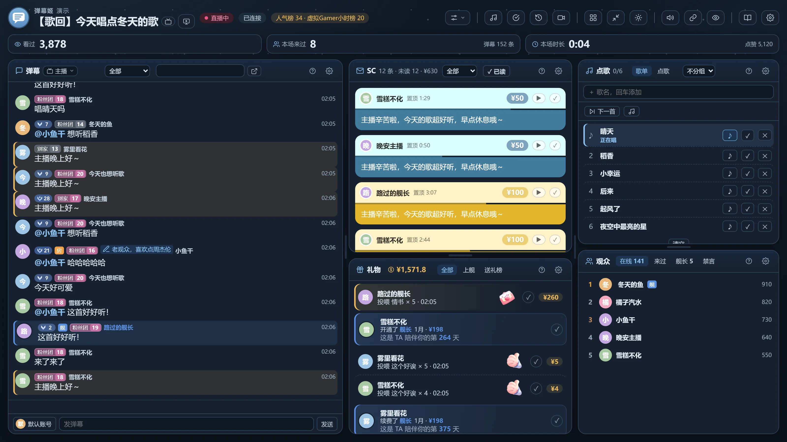
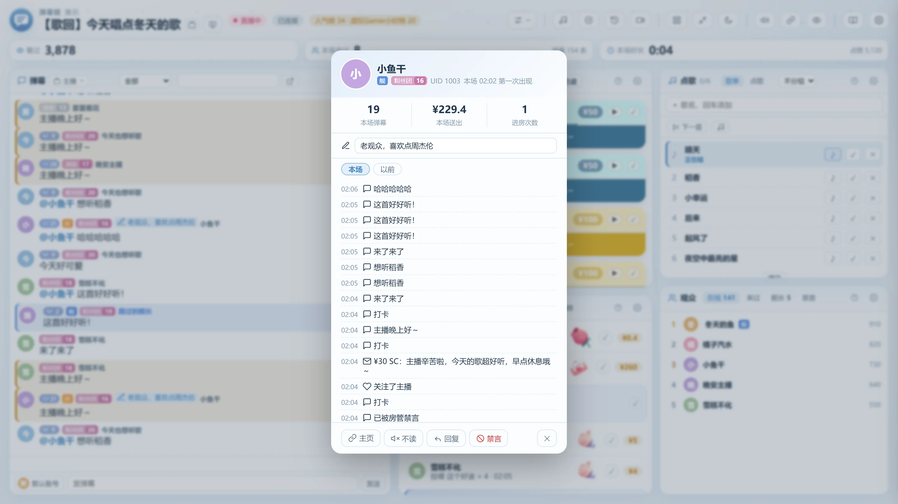
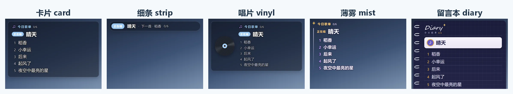

<a id="zh"></a>


# 雾幕 Danmist

**中文** | [English](#english)

[](https://github.com/xShadowMoon/Danmist/releases/latest)
[](LICENSE)

看板娘：**[雾冬Hanaki](https://live.bilibili.com/373317)**（图标里的小人就是她，欢迎来直播间玩）

给 B 站主播用的弹幕工作台。在自己电脑上运行，连上你的直播间：弹幕、礼物、SC、上舰、点歌都在一个网页里看，还能直接给 OBS 当弹幕和歌单的浏览器源。每一场直播都会自动存档，下播后随时回看。

全部运行在你自己的电脑上，不需要服务器，也不会把数据传到别的地方。


---

## 怎么用（Windows）

**最简单：安装版**（v0.9.6 起）。在 [Releases](https://github.com/xShadowMoon/Danmist/releases/latest) 下载 `Danmist-Setup-vX.Y.Z.exe`，双击就装好（不用管理员，装在 `%LOCALAPPDATA%\Programs\Danmist`），开始菜单和桌面都会有「雾幕」。第一次打开会问直播间号。以后有新版本在软件里点「下载更新」就行；不要了在「设置 → 应用」里卸载（会问要不要连存档一起删）。Windows 可能提示「已保护你的电脑」，点「更多信息 → 仍要运行」（安装包没有花钱买签名）。

**国内下载慢**：可以从百度网盘下载，安装包、免安装包和说明都在里面：https://pan.baidu.com/s/1Ag5Ykctgn8S5OyVNB30jSg?pwd=xn55 （提取码 xn55）

**免安装版**：
1. 打开 [Releases](https://github.com/xShadowMoon/Danmist/releases/latest)，下载 `Danmist-vX.Y.Z-windows-x64.zip`（自带 Python，不用另外安装）。
2. 解压到一个固定的文件夹（不要直接在压缩包里双击运行），比如 `D:\雾幕\`。
3. 双击 `start.bat`。第一次会问你的**直播间号**（直播间网址 `live.bilibili.com/` 后面那串数字），再问**打开方式**：
   - **软件窗口**（推荐，v0.9.5 起）：雾幕像一个软件一样单独开一个窗口，没有黑色窗口；桌面上会多一个「雾幕」图标，以后双击它就行。关掉窗口，雾幕就停了。
   - **浏览器**：跟以前一样，用浏览器打开 <http://127.0.0.1:8373>，关掉黑色窗口就停了。

   以后想换，在雾幕「设置 → 更多 → 桌面版」里改。
4. 在这台电脑上打开的页面拥有全部管理权限。

- 没开播也能先看看效果：双击 `demo.bat`，会在 <http://127.0.0.1:8375> 随机生成假弹幕、礼物和 SC，每种样式都能看一遍。
- 想换直播间、改端口，编辑文件夹里的 `config.json`（见下面「配置」）。
- 想让观众名字不被 B 站打码：点发弹幕框左边的头像，扫码登录一个 B 站号（建议小号），雾幕会用它连直播间。见「常见问题」。

### 接到 OBS

1. 在雾幕右上角点「OBS 弹幕」，进入可视化设置页（`/obs-setup`），选样式、字号、颜色、要显示的内容，右边是实时预览。
2. 点左下角「复制网址」。
3. 在 OBS 里添加「浏览器」来源，把网址粘进去，宽高按设置页下面写的填。
4. 歌单也一样：设置页顶上切到「歌单」，复制网址再加一个浏览器来源。

### 更新到新版本

**v0.9.5 起可以在软件里更新**：出了新版本时，顶栏「已连接」旁边会出现「新版本 vX.Y.Z」和「下载更新」。点一下，雾幕会从 GitHub 下载、核对校验码；下载好按钮变成「重启生效」，点了几秒后就换成新版本，窗口不用关（只能在运行雾幕的这台电脑上点）。`config.json`、`data\`、`python\` 不会被动。

**从老版本（v0.9.0–v0.9.4）更新**：这些版本还不能在软件里更新，手动覆盖一次（按下面 1–4 步），以后就能在软件里点「下载更新」了。

**从免安装版搬到安装版**：装好安装版后先关掉它，把老文件夹里的 `config.json` 和整个 `data` 文件夹拷进 `%LOCALAPPDATA%\Programs\Danmist`（在资源管理器地址栏粘这串就能打开），覆盖，再从开始菜单打开「雾幕」，直播间号和存档就都接上了。

v0.9.4 及以前，或者想手动更新，按下面做：

1. 关掉雾幕的黑色窗口。
2. 从 [Releases](https://github.com/xShadowMoon/Danmist/releases/latest) 下载新的 `windows-x64.zip`。
3. 解压后把里面的文件**覆盖**到原来的文件夹，提示重名时选「替换」。
4. 双击 `start.bat`。

直播间号、存档、观众备注、登录信息都在 `config.json` 和 `data\` 里，压缩包里没有这两样，所以覆盖不会丢；自己放进 `static\art\` 的图片也不会被换掉。保险起见，更新前可以先把 `data\` 复制一份。

从源码运行的话：`git pull`，再 `pip install -r requirements.txt`，然后重启。

---

## 能做什么

| 功能 | 说明 |
|---|---|
| 弹幕 | 表情显示成图片、粉丝牌（含未点亮的灰色牌）、荣耀等级、主播标签、高亮词；悬停暂停滚动，往上翻看整场，全场搜索，只看某类弹幕，弹幕小窗 |
| 发弹幕和回复 | 页内扫码登录自己的 B 站号发弹幕，可以直接回复某条弹幕；点名字能禁言、解除禁言 |
| SC | 置顶倒计时、重听、按金额筛选、标已读，已读状态在几台设备之间同步 |
| 礼物和上舰 | 礼物记录、刚送的礼物播 B 站官方动图、大礼物和上舰特效（优先用 B 站官方特效）、送礼榜（本场 / 本周 / 本月）、「开通 / 续费」「陪伴第 N 天」、下播期间收到的单独列出并可以标「已感谢」 |
| 观众 | 观众卡片（本场弹幕、送了多少、以前来过的记录）、备注、舰长名单和到期时间、在线的人、进房和新关注 |
| 点歌 | 歌单和完整曲库、弹幕点歌和点歌规则、「正在唱」「已唱」、拖动排序和分组、歌词提词小窗 |
| 朗读和提示音 | 用浏览器自带的声音朗读弹幕、SC、礼物，可以设过滤条件和屏蔽词；可选接本机的 GPT-SoVITS，用自己训练的 AI 音色念；不同事件可以配不同提示音 |
| 历史 | 每场完整保存弹幕、礼物、SC 和上舰，概览里有收益、送礼榜、礼物和上舰统计 |
| OBS 弹幕 | `/obs` 6 种样式（月见、雾凇、星扣、雾月、气泡、票根），10 款开源字体，描边阴影、按身份配色、屏蔽词，全部在 `/obs-setup` 里点选 |
| OBS 歌单 | `/obs-songs` 3 种样式（卡片、细条、唱片） |
| 斗鱼、虎牙、抖音 | 同时在斗鱼、虎牙、抖音开播时，把那边的弹幕、礼物、进房也收进来，每条标上平台（设置 → 弹幕 → 其他平台）。抖音不碰它的接口：在这台电脑上开一个看不见的浏览器窗口正常打开直播间，从页面上读，所以只能在装了 Edge 或 Chrome 的 Windows 电脑上用；不登录抖音时名字会打码，点「显示窗口」在里面登录 |
| 弹幕点歌直接放（试用） | 观众发「点歌 歌名」，从网易云 / QQ 音乐找到直接放；谁能点、每人几首、要不要你同意、谁能切歌都能设；OBS 加 `/obs-music` 浏览器源出声 |
| 直播间 | 改标题和分区、常用标题一键切换、直播画面小窗、人气榜和小时榜、超管警告和切断提醒 |
| 开播前自检 | 一键检查和 B 站的连接、登录、OBS 能不能收到；工作模式（唱歌 / 聊天 / 房管）一键换布局 |
| 更新提醒 | GitHub 上出了新版本时，在顶栏提示（只有管理身份能看到），点开看更新内容和下载 |
| 布局 | 模块随意拖动、改大小、加减；主题色、配色、深色模式、紧凑模式；设置方案可以导出导入；能装成桌面应用（PWA） |
| 分享 | 只读的普通链接、可以随时新建和作废的管理链接、给主播本人用的专属链接（`/host`） |
| 切换直播间 | 临时去看你列出来的别的直播间，不影响自己的记录 |

### 界面一览








> 截图都来自演示模式（`demo.bat`），里面的观众和弹幕是随机生成的。

---

## 从源码运行（Windows / macOS / Linux）

需要 Python 3.11 或更新。

```sh
git clone https://github.com/xShadowMoon/Danmist.git
cd Danmist
pip install -r requirements.txt
cp config.example.json config.json   # 把 room 改成你的直播间号
python server.py                     # 然后打开 http://127.0.0.1:8373
```

Windows 上也可以直接双击 `start.bat`：它会自己找电脑上的 Python，第一次运行时自动装依赖、问直播间号。

不连直播间先看看：`python server.py --demo --port 8375`。

弹幕连接用的是 xfgryujk 的 [blivedm](https://github.com/xfgryujk/blivedm)（MIT），放在 `blivedm-src/` 里，有少量改动。

## 配置

`config.json`（除了 `room` 都可以不填；命令行参数会覆盖它，见 `python server.py --help`）：

| 键 | 含义 |
| --- | --- |
| `room` | 要连接的直播间号。 |
| `anchor_name` | 你的名字，显示在切换直播间的列表里。 |
| `port`、`host` | 网页监听的地址，默认 `127.0.0.1:8373`。 |
| `login_file` | 一个 B 站账号的登录文件，用来读取直播间（见常见问题）。默认 `data/bili-login.json`。 |
| `public_url` | 如果你把页面放到了公网，填公网地址（用于「隧道断了」提醒）。 |
| `discord_webhook` | 掉线提醒和每日体检发到的 Discord webhook。留空就不发。 |
| `bot_say_url` | 可选：用机器人账号发弹幕的本地接口（POST `{"text": ...}`，请求头 `X-Local-Token` 读自 `bot.token`）。 |
| `update_check` | 是否检查有没有新版本，默认 `true`。写 `false` 就不检查（也可以加命令行参数 `--no-update-check`）。 |
| `ai_voice` | 可选：朗读用的 AI 音色（GPT-SoVITS），见下面「AI 音色」。`url` 留空就不用。 |
| `brand` | 可选：`{"name": "软件叫什么", "short": "网页里怎么称呼你", "medal": "粉丝牌名字"}`，默认「雾幕 / 主播 / 粉丝团」。 |
| `pack` | 可选：你自己的「包」文件夹。包里 `static/` 下的同名文件优先（自己的图、公告、manifest），`static/ext/{页面}.css`、`.js` 会自动加进对应页面（比如额外的 OBS 样式）。不进 git，可以放私有的东西。 |
| `host_path` | 可选：主播专属链接的地址，默认 `/host`。 |
| `login_readonly` | 可选：`true` 时只读登录文件、不往里写（登录文件是别的程序的时候用）。 |
| `discord_webhook_file`、`alert_port` | 可选：从别的程序的 JSON 配置里读 `discord_webhook`；只有这个端口的那份发掉线提醒（同一个文件夹里另开的测试直播间不发）。 |
| `gequ_dir` | 可选：把一个文件夹里的 `index.html`、`songs.json` 公开成 `/gequ.html`、`/gequ.json`（给粉丝站读歌切合集）。 |

其他本地文件（都不会进 git，也不会打进 Release 压缩包）：

- `admin.key`：里面写一串随机字符就能开启一把长期管理链接（`/?admin=<那串字符>`）。更推荐在页面「设置 → 链接」里新建可作废的管理链接。
- `data/`：直播存档、设置、观众备注和登录的账号。记得备份，千万别公开。

### AI 音色（GPT-SoVITS，可选）

朗读除了浏览器自带的声音，还可以用 [GPT-SoVITS](https://github.com/RVC-Boss/GPT-SoVITS) 训练出来的声音，比如你自己的声音。雾幕只负责把要念的字发给本机的 GPT-SoVITS，拿回声音在网页里播放，安装包里不带模型，也不带 PyTorch。

**需要**：NVIDIA 显卡（显存 6 GB 以上比较稳）和 GPT-SoVITS（官方整合包或源码都行）。没有显卡也能跑，只是很慢，不适合直播时用。

1. **训练**：打开 GPT-SoVITS 的 WebUI，准备几分钟去掉背景音乐的干净人声，按 WebUI 的步骤切分、转写、训练，得到一个 GPT 模型（`.ckpt`）和一个 SoVITS 模型（`.pth`）。再挑一段 3 到 10 秒、说话清楚的录音当参考音频，记下它说的是什么。也可以直接用别人分享的模型（注意授权）。
2. **开服务**：在 GPT-SoVITS 文件夹里用它自带的 Python 运行 `api_v2.py -a 127.0.0.1 -p 9880`，看到监听 9880 就好了。
3. **写配置**：在 `config.json` 里加上（路径换成你自己的，Windows 路径里的反斜杠要写成 `/` 或者两个反斜杠）：

   ```json
   "ai_voice": {
     "url": "http://127.0.0.1:9880",
     "api": "api_v2",
     "voices": [
       {
         "name": "我的声音",
         "ref_audio": "D:/GPT-SoVITS/参考音频/我.wav",
         "ref_text": "参考音频里说的那句话",
         "ref_lang": "zh",
         "gpt": "D:/GPT-SoVITS/GPT_weights_v2Pro/我的声音-e15.ckpt",
         "sovits": "D:/GPT-SoVITS/SoVITS_weights_v2Pro/我的声音_e8_s200.pth"
       }
     ]
   }
   ```

   可以写好几个音色，切换音色时会自动换模型。每个音色还能加 `"speed": 1.1`（语速）、`"text_lang"`（念的语言，默认 `zh`）、`top_k`、`top_p`、`temperature`。`ref_lang` 是参考音频的语言：`zh`、`ja`、`en`、`ko`、`yue`。
4. **重启雾幕**，在「设置 → 朗读 → 声音」里选「AI 音色」下面的声音。

**说明**

- 只有管理身份能用 AI 音色（普通链接看不到），不然谁都能拿这个接口让你的声音说任意的话。声音在打开页面的那台电脑上播放。
- 「AI 声音念」默认是「只念感谢」：礼物、上舰、关注、进房的感谢用 AI 声音；弹幕和 SC 是观众自己写的字，照常用浏览器的声音，免得有人借你的声音说怪话被剪出去。想全部用 AI 声音，改成「全部」（屏蔽词照样有用）。
- 正在念一句时，后面两句会先合成好。第一次合成要装模型，可能要半分钟；之后一句一般几秒。等了 10 秒还没好，或者服务没开，这一句就改用浏览器的声音，不会卡住。
- 声音的语速跟着「语速」滑块走（1.15 倍算正常速度），「音调」对 AI 声音不起作用。
- 也支持「一个音色一个文件夹」的服务：`"api": "folder"`，服务要提供 `GET /voices`（返回 `{"voices": ["名字", ...]}`）和 `POST /tts?voice=名字&speed=1.0`（请求体是要念的文字，返回 wav）。`names` 可以给音色起显示的名字，`hide` 可以藏掉不想显示的。
- 用真人的声音之前，先征得本人同意；对外发的时候说明是 AI 合成。

### 分享给房管或主播

默认只监听 `127.0.0.1`，只有这台电脑能打开（同一个 Wi-Fi 的手机见下面）。想发到外网，就放在反向代理或隧道（比如 Cloudflare Tunnel）后面，并填好 `public_url`：

- **普通链接**：只读，看不到收益、礼物价格、历史和备注，也不能操作。
- **管理链接**：在「设置 → 链接」里新建，给房管用，可以随时作废或换新。
- **主播专属链接**（`/host`）：给主播本人，界面更简单。

### 弹幕点歌直接放（试用）

设置 → 点歌 → 「弹幕点歌直接放」打开后，观众发「点歌 歌名」（或「点歌 歌名 - 歌手」）就会排进歌单最上面的「放歌」，按顺序放；发「切歌」按你设的规则切。
- 曲库选网易云或 QQ 音乐，扫码登录后会员歌也能放（不登录只能放免费的）。登录信息只存在本机 `data/music-login.json`。
- 网页放：OBS 里加一个浏览器源，网址填设置里给的 `/obs-music`（勾上「通过 OBS 控制音频」调音量）；不用 OBS 就在歌单的放歌栏点喇叭，让这个页面出声。
- 电脑上的网易云：让这台电脑上装的网易云客户端放（只支持 Windows + 网易云）。
- 谁能点：所有人 / 舰长以上，粉丝牌、荣耀等级门槛，每人同时排几首，要不要你先同意。

### 手机打开（同一个 Wi-Fi）

设置 → 链接 → 打开「同一个 Wi-Fi 能打开」，下面会给出 `http://电脑的局域网地址:8373`，同一个 Wi-Fi 的手机、平板输入就能看。要在手机上管理，就在同一页新建一个管理链接，用手机扫弹出来的二维码。第一次打开时 Windows 可能问要不要允许网络访问，选「专用网络」允许。也可以直接在 `config.json` 写 `"lan": true`。

### 自己的图片

除了应用图标，不带任何美术图。舰长徽章、头像框、上舰横幅和看板娘用到的文件名见 [`static/art/README.md`](static/art/README.md)，放进去刷新就生效。也可以放进自己的包（`config.json` 的 `pack`）里的 `static/art/`，升级时不会被覆盖。

---

## 常见问题

| 现象 | 原因和处理 |
|---|---|
| 观众名字被打码（中间变成 `*`） | B 站不给未登录的连接看完整名字。点发弹幕框左边的头像扫码登录一个 B 站号（建议小号）：v0.9.4 起，还没有连直播间的登录时会自动用这个号连，几秒后新弹幕就是完整名字（之前的弹幕不会变）。v0.9.3 及以前扫码登录只用来发弹幕，要更新到新版。也可以手动把 Cookie 存成 `data/bili-login.json`：`{"cookie": "SESSDATA=...; bili_jct=...; DedeUserID=..."}`。**登录信息等于账号密码**，只在自己电脑上。 |
| 双击 `start.bat` 一闪就没了 | 多半是解压不完整，或者在压缩包里直接运行。完整解压到一个普通文件夹再试；还不行就在那个文件夹里打开命令行运行 `start.bat` 看报错。 |
| 提示端口 8373 被占用 | 可能已经开着一个雾幕，直接打开 <http://127.0.0.1:8373> 就行；要换端口，改 `config.json` 里的 `port`。 |
| 想换直播间 | 改 `config.json` 里的 `room`，关掉窗口重新打开。 |
| OBS 里什么都不显示 | 先在浏览器里打开同一个网址看看有没有弹幕；确认雾幕那个黑色窗口还开着；OBS 浏览器源的网址必须是从设置页复制的完整网址。也可以用顶栏「开播前自检 → OBS 测试」。 |
| 扫码登录没反应 | 用的是旧版的话缺 `qrcode` 依赖：源码运行时执行 `pip install -r requirements.txt`，或者下载新版 Windows 包。 |
| 别人打开我的公网链接看不到收益和历史 | 这是故意的：普通链接是只读视角。给信任的人发「管理链接」。 |
| 改标题、改分区提示没权限 | 这些操作要用**主播本人**的 B 站号扫码登录（发送框左边的头像）。 |
| 怎么看现在是哪个版本 | 鼠标停在「有新版本」标签上会写现在的版本；也可以在文件夹里运行 `python\python.exe server.py --version`（源码运行是 `python server.py --version`）。 |
| 浏览器不朗读 | 浏览器要求网页先被点过一下才能出声；点一下页面再试。声音列表来自系统，Windows 自带中文语音即可。 |

## 免责声明

- 本工具是第三方的非官方工具，与哔哩哔哩无关。
- 在雾幕里扫码登录、保存 Cookie、用账号发弹幕 / 禁言 / 改标题 / 开播，都是在用你自己的账号操作。B 站可能限制、风控或封禁使用第三方工具的账号，**由此造成的任何损失（包括账号被封禁）由使用者自己承担，作者不承担任何责任**。建议连接直播间用小号。
- 使用本工具即表示你同意以上内容。

## 数据与隐私

- 所有数据（直播存档、观众备注、设置、登录信息）都只存在本机的 `data/` 文件夹里，不会上传到任何地方。
- 页面里扫码登录的 B 站账号只存在电脑的 `data/accounts/` 里，浏览器只拿到一串随机口令。
- 管理链接只以哈希形式保存，作废后立即失效。
- 不收集任何使用数据。对外连接只有 B 站本身、你自己填的 Discord webhook，以及每天一次去 GitHub 查最新版本号（只读版本号，不带任何账号或直播间信息，可以用 `update_check` 关掉）。

## 测试

```sh
python -m unittest discover -s tests   # 离线后端测试（240 多项）
python tests/run_ui.py                 # 开一个演示服务，用无头 Edge / Chrome 查每个页面有没有报错、弹幕跟随对不对
python tests/run_ui.py --config 你的config.json   # 带上自己的包一起查
python tests/smoke_demo.py             # 在 8390 端口启动演示服务器，检查页面和 WebSocket
```

打 Windows 包：`powershell -ExecutionPolicy Bypass -File scripts\build-windows.ps1 -Version 0.9.0`，输出在 `dist\`。

## 更新日志

见 [CHANGELOG.md](CHANGELOG.md)。

## 字体和许可

- `static/fonts/` 里可选的 OBS 字体是 SIL Open Font License 1.1 字体的子集，来源见 [`static/fonts/LICENSES.txt`](static/fonts/LICENSES.txt)。
- 代码采用 [MIT](LICENSE) 许可。`blivedm-src/` 保留它自己的 MIT 许可。
- 本项目与哔哩哔哩无关，是非官方工具，请遵守 B 站的用户协议。

---

<a id="english"></a>

# Danmist (雾幕)

[中文](#zh) | **English**

Mascot: **[雾冬Hanaki](https://live.bilibili.com/373317)**, the girl in the icon. Come say hi on her stream!

A self-hosted live-stream dashboard for **Bilibili Live** streamers. It runs on your own computer, connects to your live room, and puts danmaku, gifts, Super Chats, guard purchases and song requests in one customizable web page. It also serves OBS browser sources for on-stream danmaku and song-list overlays, and archives every stream so you can look back later.

Everything runs locally. No server, no account with us, nothing is uploaded anywhere.


---

## Getting started (Windows)

**Easiest: the installer** (from v0.9.6). Download `Danmist-Setup-vX.Y.Z.exe` from [Releases](https://github.com/xShadowMoon/Danmist/releases/latest) and double-click it. No admin rights needed; it installs to `%LOCALAPPDATA%\Programs\Danmist` and adds 雾幕 to the Start menu and desktop. The first launch asks for your room id. Later updates are one click inside the app; uninstall from Settings → Apps (it asks whether to delete your archives too). Windows SmartScreen may warn about an unknown publisher (the installer isn't code-signed): click "More info → Run anyway".

**Slow downloads in mainland China**: the same files are on Baidu Netdisk: https://pan.baidu.com/s/1Ag5Ykctgn8S5OyVNB30jSg?pwd=xn55 (code xn55)

**Portable zip**:
1. Go to [Releases](https://github.com/xShadowMoon/Danmist/releases/latest) and download `Danmist-vX.Y.Z-windows-x64.zip`. Python is bundled; nothing else to install.
2. Unzip it to a normal folder (don't run it from inside the zip).
3. Double-click `start.bat`. The first time, it asks for your **live room id** (the number after `live.bilibili.com/`) and how to open it:
   - **App window** (recommended, from v0.9.5): the board opens in its own window with no console; a 雾幕 shortcut appears on the desktop for next time. Closing the window stops the board.
   - **Browser**: as before, your browser opens <http://127.0.0.1:8373>; close the console window to stop.

   Change it later under Settings → More → Desktop.
4. Pages opened on this computer have full admin rights.

- Try it without going live: `demo.bat` generates fake danmaku, gifts and Super Chats at <http://127.0.0.1:8375>.
- To change room or port, edit `config.json` (see Configuration).
- To stop Bilibili from masking viewer names, click the avatar left of the send box and log in to a Bilibili account by QR code (a secondary account is recommended); the board uses it for the room connection. See FAQ.

### Adding it to OBS

1. Click **OBS 弹幕** at the top right of the dashboard to open the visual setup page (`/obs-setup`). Pick a style, size, colours and what to show; the preview on the right updates live.
2. Click **复制网址** (copy URL) at the bottom left.
3. In OBS, add a **Browser** source, paste the URL and use the width/height shown on the setup page.
4. Same for the song list: switch the setup page to **歌单** and add a second browser source.

### Updating to a new version

**From v0.9.5 you can update inside the app**: when a new version is out, a "new version vX.Y.Z" tag with a **download update** button appears next to the connection status. The board downloads it from GitHub and checks the checksum; then the button turns into **restart**, and a few seconds later you're on the new version without closing the window (only on the computer running the board). `config.json`, `data\` and `python\` are left alone.

**From older versions (v0.9.0–v0.9.4)**: these can't update themselves yet. Update by hand once (steps 1–4 below); after that, use **download update** inside the app.

**Moving from the portable zip to the installer**: install, close the app, copy `config.json` and the whole `data` folder from your old folder into `%LOCALAPPDATA%\Programs\Danmist` (paste that into the Explorer address bar), then start 雾幕 from the Start menu. Your room and archives carry over.

Up to v0.9.4, or to update by hand:

1. Close the console window.
2. Download the new `windows-x64.zip` from [Releases](https://github.com/xShadowMoon/Danmist/releases/latest).
3. Unzip it and copy the files **over** your existing folder, replacing files when asked.
4. Double-click `start.bat`.

Your room id, archives, viewer notes and logins live in `config.json` and `data\`, which are not in the zip, so nothing is lost; images you put in `static\art\` are kept too. To be extra safe, copy `data\` somewhere first.

Running from source: `git pull`, `pip install -r requirements.txt`, then restart.

---

## Features

| Feature | Details |
|---|---|
| Danmaku | Emoticons as images, fan medals (including unlit grey ones), honour levels, host tag, highlight words; pause on hover, scroll back through the whole stream, search, filters, pop-out window |
| Sending and replying | Log in with your own Bilibili account by QR code to send danmaku and reply to a specific message; mute and unmute viewers |
| Super Chats | Pinned with countdown, replay, filter by amount, mark as read; read state syncs across devices |
| Gifts and guards | Gift log, official animated gift icons, big gift and guard purchase effects (official Bilibili effects when available), gift ranking for this stream / week / month, "new / renewed" and "day N together", gifts received while offline listed separately with a "thanked" checkbox |
| Viewers | Viewer card (this stream's messages, total spent, past visits), notes, guard list with expiry, who is online, entries and new follows |
| Song requests | Song list and full song library, requests from danmaku with rules, "now singing" / "done", drag to reorder, groups, lyrics prompter |
| Text-to-speech and sounds | Read danmaku, SC and gifts aloud with the browser's voices, with filters and blocked words; optionally use your own trained voice through a local GPT-SoVITS; separate notification sounds per event |
| History | Every stream archived with full danmaku, gifts, SC and guards; per-stream summary with revenue and rankings |
| OBS danmaku overlay | `/obs` with 6 styles (moon, rime, clip, luna, bubble, ticket), 10 open-source fonts, outline and shadow, colours by guard level, blocked words, all configured visually at `/obs-setup` |
| OBS song overlay | `/obs-songs` with 3 styles (card, strip, vinyl) |
| Douyu, Huya and Douyin | Also streaming on Douyu, Huya or Douyin? Their danmaku, gifts and entries come in too, tagged by platform (Settings → Danmaku → Other platforms). Douyin doesn't use its APIs: an off-screen browser window on this PC opens the live room normally and reads the page, so it needs Windows with Edge or Chrome; names are masked until you log in to Douyin via "Show window" |
| Song requests that play (preview) | Viewers send 「点歌 song name」 and it plays from NetEase Cloud Music or QQ Music; set who may request, how many each, whether you approve, and who may skip; add `/obs-music` as an OBS browser source for the audio |
| Live room | Change title and area, saved title presets, live video pop-out, popularity and hourly ranks, warnings from Bilibili moderators |
| Pre-stream check | One click to check the Bilibili connection, login and OBS; work modes (singing / chatting / moderating) switch layouts |
| Update reminder | Shows a tag at the top when a new version is on GitHub (admins only), linking to the release notes and download |
| Layout | Drag, resize, add and remove panels; accent colour, palettes, dark mode, compact mode; export and import presets; installable as a desktop app (PWA) |
| Sharing | Read-only public link, revocable admin links, and a separate host link (`/host`) for the streamer |
| Room switching | Peek at other live rooms from a list you control without touching your own records |

### Screenshots


> All screenshots are from demo mode (`demo.bat`); viewers and messages are randomly generated.

---

## Running from source (Windows / macOS / Linux)

Requires Python 3.11 or newer.

```sh
git clone https://github.com/xShadowMoon/Danmist.git
cd Danmist
pip install -r requirements.txt
cp config.example.json config.json   # then set room to your live room id
python server.py                     # then open http://127.0.0.1:8373
```

On Windows you can also double-click `start.bat`: it finds your Python, installs the dependencies the first time and asks for the room id.

Try it without a live room: `python server.py --demo --port 8375`.

The danmaku connection uses [blivedm](https://github.com/xfgryujk/blivedm) by xfgryujk (MIT), bundled in `blivedm-src/` with small local changes.

## Configuration

`config.json` (all optional except `room`; command-line flags override it, see `python server.py --help`):

| Key | Meaning |
| --- | --- |
| `room` | Live room id to connect to. |
| `anchor_name` | Your name, shown in the room switcher. |
| `port`, `host` | Where the web page listens. Default `127.0.0.1:8373`. |
| `login_file` | Login file of a Bilibili account used to read the room (see FAQ). Default `data/bili-login.json`. |
| `public_url` | Your public address if you expose the page (for the "tunnel is down" alert). |
| `discord_webhook` | Discord webhook for connection alerts and the daily health check. Empty = no alerts. |
| `bot_say_url` | Optional local endpoint that sends danmaku from a bot account (POST `{"text": ...}`, header `X-Local-Token` read from `bot.token`). |
| `update_check` | Check GitHub for new versions, default `true`. Set `false` to turn it off (or pass `--no-update-check`). |
| `ai_voice` | Optional AI voices for text-to-speech (GPT-SoVITS), see "AI voices" below. Leave `url` empty to turn it off. |
| `brand` | Optional `{"name": app name, "short": what pages call you, "medal": fan medal name}`. Defaults: 雾幕 / 主播 / 粉丝团. |
| `pack` | Optional folder with your own files. Files under its `static/` override the built-in ones (artwork, announcements, manifests); `static/ext/{page}.css` / `.js` are added to that page automatically (e.g. extra OBS styles). Kept out of git, so private things can live there. |
| `host_path` | Optional path for the streamer-only link, default `/host`. |
| `login_readonly` | Optional: `true` to only read the login file, never write it (when another program owns it). |
| `discord_webhook_file`, `alert_port` | Optional: read `discord_webhook` from another program's JSON config; only the instance on this port sends alerts (test rooms in the same folder stay quiet). |
| `gequ_dir` | Optional: publish `index.html` and `songs.json` from a folder as `/gequ.html` and `/gequ.json`. |

Other local files (ignored by git and never included in release zips):

- `admin.key`: put a random string in it to enable a long-lived admin link (`/?admin=<string>`). Revocable admin links created under Settings → Links are the better option.
- `data/`: stream archives, settings, viewer notes and logged-in accounts. Back it up; never publish it.

### AI voices (GPT-SoVITS, optional)

Besides the browser's voices, text-to-speech can use a voice trained with [GPT-SoVITS](https://github.com/RVC-Boss/GPT-SoVITS), for example your own. The board only sends the text to a GPT-SoVITS server on your computer and plays the audio in the page; no models or PyTorch are bundled.

**You need** an NVIDIA GPU (6 GB of VRAM or more is comfortable) and GPT-SoVITS (the official bundle or source). It runs on CPU too, but too slowly for live use.

1. **Train**: in the GPT-SoVITS WebUI, take a few minutes of clean speech without music and follow the WebUI steps (slice, transcribe, train) to get a GPT model (`.ckpt`) and a SoVITS model (`.pth`). Pick a clear 3–10 second clip as the reference audio and note what it says. Shared models work too (mind their licence).
2. **Start the server**: in the GPT-SoVITS folder, run `api_v2.py -a 127.0.0.1 -p 9880` with its Python.
3. **Configure**: add this to `config.json` (use your own paths; write Windows paths with `/` or double backslashes):

   ```json
   "ai_voice": {
     "url": "http://127.0.0.1:9880",
     "api": "api_v2",
     "voices": [
       {
         "name": "My voice",
         "ref_audio": "D:/GPT-SoVITS/ref/me.wav",
         "ref_text": "What the reference clip says",
         "ref_lang": "zh",
         "gpt": "D:/GPT-SoVITS/GPT_weights_v2Pro/me-e15.ckpt",
         "sovits": "D:/GPT-SoVITS/SoVITS_weights_v2Pro/me_e8_s200.pth"
       }
     ]
   }
   ```

   You can list several voices; models are switched automatically. Each voice can also set `"speed"`, `"text_lang"` (language to speak, default `zh`), `top_k`, `top_p` and `temperature`. `ref_lang` is the reference clip's language: `zh`, `ja`, `en`, `ko` or `yue`.
4. **Restart the board** and pick the voice under "AI voices" in Settings → Text-to-speech → Voice.

**Notes**

- Only admins can use AI voices (the public link doesn't see them); otherwise anyone could make your voice say anything. Audio plays on the computer that has the page open.
- "AI voice reads" defaults to "thanks only": gifts, guards, follows and entries are thanked in the AI voice, while danmaku and SC (written by viewers) keep the browser voice, so nobody can put words in your mouth. Switch it to "everything" if you like (blocked words still apply).
- The next two lines are synthesised while the current one plays. The very first line loads the model and can take half a minute; after that a line usually takes a few seconds. If a line isn't ready within 10 seconds, or the server is off, that line falls back to the browser voice.
- Speed follows the "Speed" slider (1.15× is normal speed); "Pitch" doesn't apply to AI voices.
- A "one folder per voice" server is also supported with `"api": "folder"`: it must offer `GET /voices` (returning `{"voices": ["name", ...]}`) and `POST /tts?voice=name&speed=1.0` (the body is the text; returns wav). `names` sets display names and `hide` hides voices.
- Get the person's consent before cloning a real voice, and say it's AI-generated when you share it.

### Sharing with moderators or the streamer

By default it only listens on `127.0.0.1` (see below for phones on the same Wi-Fi). To share it over the internet, put it behind a reverse proxy or tunnel (for example Cloudflare Tunnel) and set `public_url`:

- **Public link**: read-only, no revenue, gift prices, history or notes, no actions.
- **Admin links**: created under Settings → Links for moderators; revoke or rotate any time.
- **Host link** (`/host`): for the streamer, with a simpler interface.

### Song requests that play (preview)

Turn on Settings → Song requests → "Play song requests". Viewers send 「点歌 song name」 (or 「点歌 song - artist」) and the song joins the "Playing" queue at the top of the song list; 「切歌」 skips according to your rule.
- Choose NetEase Cloud Music or QQ Music; log in by QR code to play VIP songs (without login only free songs play). Login data stays in `data/music-login.json` on your computer.
- Web playback: add an OBS browser source with the `/obs-music` URL shown in settings (tick "Control audio via OBS"), or click the speaker in the queue to play on that page.
- Desktop NetEase app: plays through the NetEase Cloud Music client on this computer (Windows only).
- Rules: everyone or guards only, fan-medal and honor-level thresholds, songs per person, and whether you approve first.

### Opening it on a phone (same Wi-Fi)

Settings → Links → turn on "Open on the same Wi-Fi". It shows `http://<your computer's LAN address>:8373`, which phones and tablets on the same Wi-Fi can open. To manage from the phone, create an admin link on the same page and scan the QR code it shows. Windows may ask whether to allow network access the first time; allow it for private networks. You can also set `"lan": true` in `config.json`.

### Your own artwork

No artwork is included apart from the app icon. See [`static/art/README.md`](static/art/README.md) for the file names used for guard badges, avatar frames, banners and mascots.

---

## FAQ

| Problem | Cause and fix |
|---|---|
| Viewer names are masked with `*` | Bilibili hides full names from logged-out connections. Click the avatar left of the send box and log in by QR code (a secondary account is recommended). From v0.9.4, if the room connection has no login yet, the board uses this account and reconnects, so new danmaku show full names (older ones stay masked). Up to v0.9.3 the QR login was only used for sending danmaku, so update first. You can also save a cookie as `data/bili-login.json`: `{"cookie": "SESSDATA=...; bili_jct=...; DedeUserID=..."}`. **Login data is as good as the password**: keep it on your computer only. |
| `start.bat` flashes and closes | Usually the zip wasn't fully extracted, or it was run from inside the zip. Extract to a normal folder; if it still fails, run `start.bat` from a command prompt in that folder to see the error. |
| Port 8373 is already in use | Another copy is probably running; just open <http://127.0.0.1:8373>. To use another port, change `port` in `config.json`. |
| Switch to another room | Change `room` in `config.json` and restart. |
| Nothing shows in OBS | Open the same URL in a browser first; make sure the console window is still open; copy the full URL from the setup page. The pre-stream check has an OBS test. |
| QR login does nothing | Older copies were missing the `qrcode` dependency: run `pip install -r requirements.txt`, or download the new Windows package. |
| People with the public link can't see revenue or history | By design: the public link is read-only. Send trusted people an admin link. |
| Changing the title or area says no permission | These need the **streamer's own** Bilibili account, logged in by QR code (avatar left of the send box). |
| Which version am I on? | Hover over the "new version" tag, or run `python\python.exe server.py --version` in the folder (`python server.py --version` from source). |
| Text-to-speech is silent | Browsers only play sound after you've clicked the page once. Voices come from your operating system. |

## Disclaimer

- This is an unofficial third-party tool, not affiliated with Bilibili.
- Logging in by QR code, saving a cookie, and sending danmaku, muting, changing the title or going live all act through your own Bilibili account. Bilibili may restrict or ban accounts that use third-party tools. **You use it at your own risk: the author is not responsible for any loss, including a banned account.** A secondary account is recommended for the room connection.
- By using this tool you accept these terms.

## Data and privacy

- All data (archives, viewer notes, settings, login info) stays in the local `data/` folder and is never uploaded.
- Accounts logged in from the page are stored only in `data/accounts/` on the computer; the browser just gets a random token.
- Admin links are stored only as hashes and stop working as soon as they're revoked.
- No analytics. The only outside connections are to Bilibili itself, the Discord webhook you configure, and a once-a-day request to GitHub for the latest version number (no account or room info is sent; turn it off with `update_check`).

## Tests

```sh
python -m unittest discover -s tests   # offline backend tests (240+)
python tests/run_ui.py                 # starts a demo server and checks every page for errors plus danmaku auto-follow, in headless Edge / Chrome
python tests/run_ui.py --config your-config.json   # same, with your own pack
python tests/smoke_demo.py             # starts a demo server on port 8390 and checks the pages and WebSocket
```

Build the Windows package: `powershell -ExecutionPolicy Bypass -File scripts\build-windows.ps1 -Version 0.9.0`; output goes to `dist\`.

## Changelog

See [CHANGELOG.md](CHANGELOG.md).

## Fonts and license

- The optional OBS fonts in `static/fonts/` are subsets of fonts under the SIL Open Font License 1.1. Sources are listed in [`static/fonts/LICENSES.txt`](static/fonts/LICENSES.txt).
- Code is [MIT](LICENSE) licensed. `blivedm-src/` keeps its own MIT license.
- This is an unofficial tool, not affiliated with Bilibili. Use it in line with Bilibili's terms of service.
